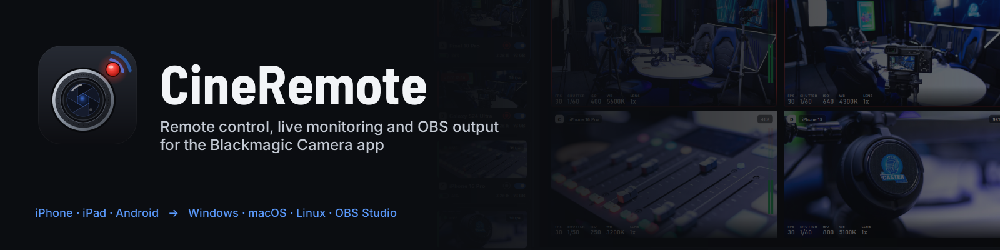
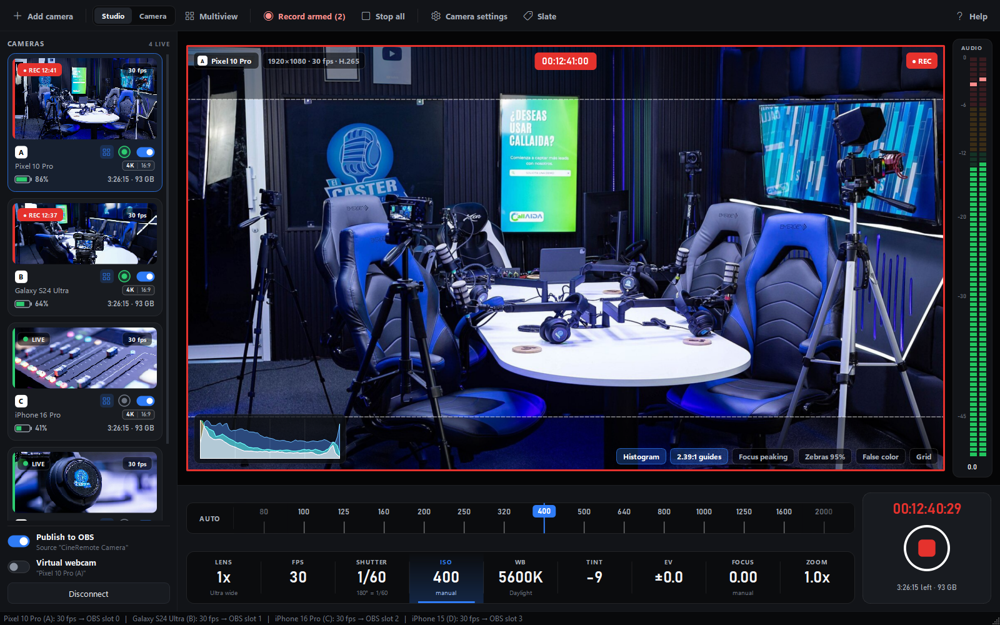
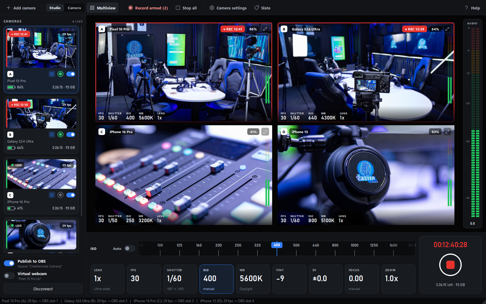
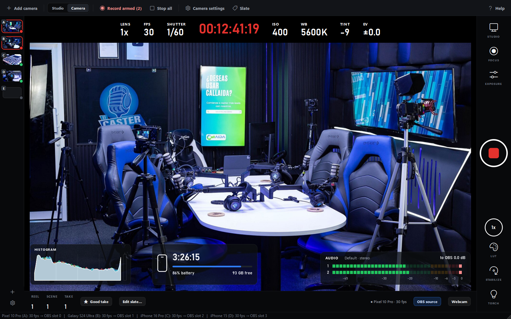
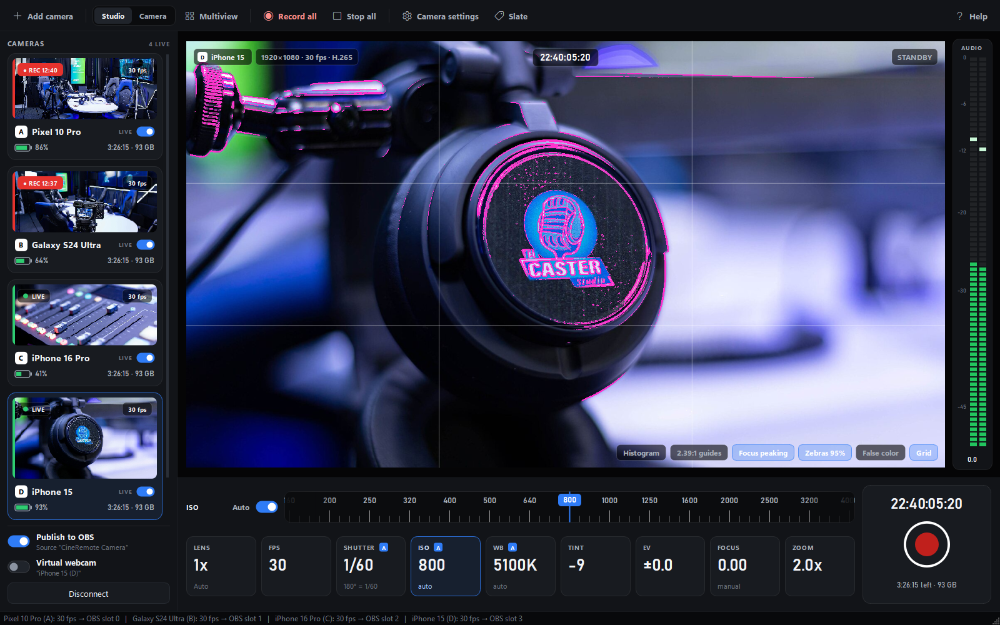
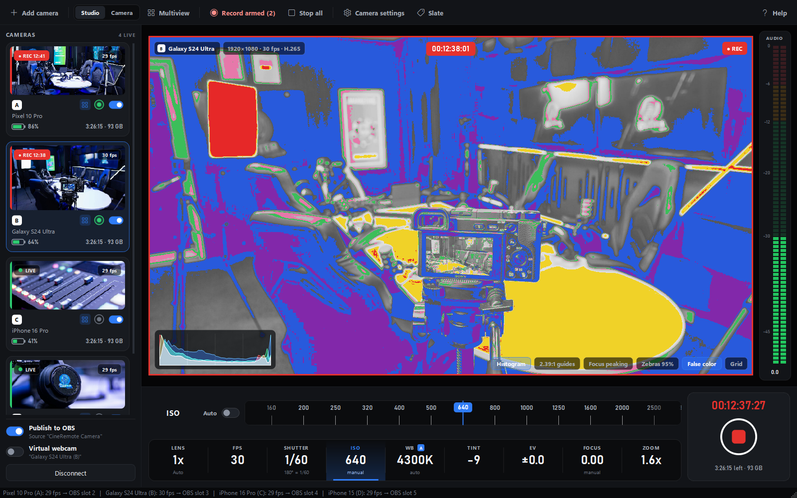
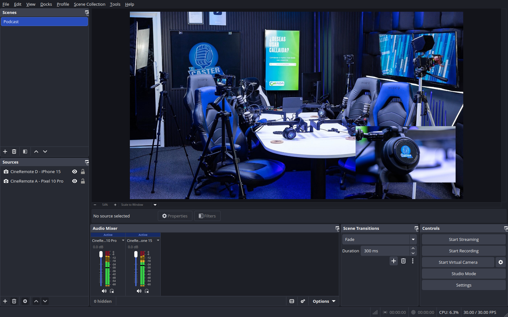
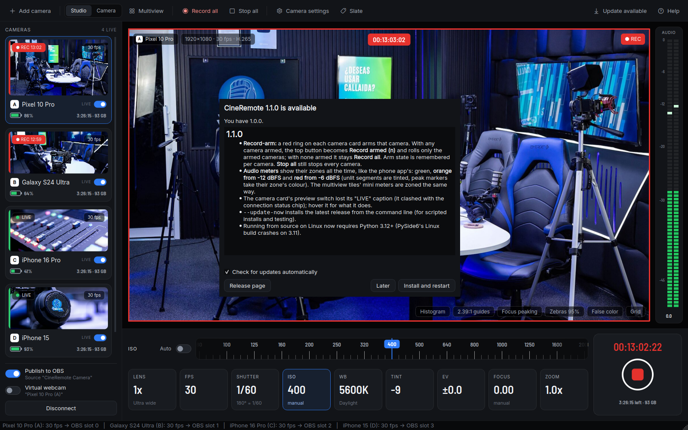
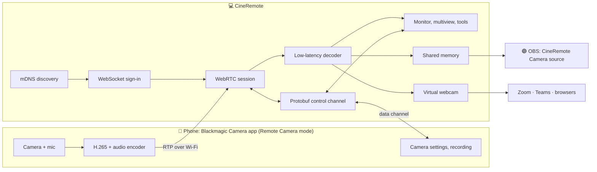

<p align="center">
  
</p>

<p align="center">
  <a href="https://github.com/jimmyvegas29/cineremote/releases/latest"></a>
  <a href="https://github.com/jimmyvegas29/cineremote/actions/workflows/build.yml"></a>
  
  <a href="LICENSE"></a>
  
</p>

**CineRemote** is a free, open-source desktop remote for the **Blackmagic Camera app** on **iPhone, iPad and
Android**. Point a phone at your shot, open CineRemote on a Windows PC, Mac or Linux box on the same Wi-Fi, and
you get a low-latency live picture with audio, every camera setting at your fingertips, start/stop recording
on one phone or all of them, and a clean feed straight into **OBS Studio** (native source) or any app as a
**virtual webcam**.

It speaks the Blackmagic Camera app's own *Remote Camera* protocol, so nothing gets installed on the phone:
the camera app you already use stays the camera.

> [!NOTE]
> CineRemote is an independent project. It is **not affiliated with, endorsed by or supported by
> Blackmagic Design**. "Blackmagic Camera" and "Blackmagic Design" are trademarks of Blackmagic Design Pty Ltd.



---

## Contents

- [Features](#features)
- [Screenshots](#screenshots)
- [Download and install](#download-and-install)
- [Set up your phone](#set-up-your-phone)
- [Using CineRemote](#using-cineremote)
- [OBS Studio](#obs-studio)
- [Virtual webcam](#virtual-webcam)
- [Try it without a phone (demo mode)](#try-it-without-a-phone-demo-mode)
- [Updates](#updates)
- [How it works](#how-it-works)
- [Run from source / build it yourself](#run-from-source--build-it-yourself)
- [Troubleshooting](#troubleshooting)
- [Project layout](#project-layout)
- [Credits](#credits)
- [Built with Claude](#built-with-claude)

## Features

| | |
|---|---|
| 📡 **Finds your phones** | Phones running Blackmagic Camera show up automatically (mDNS / Bonjour). Or add one by IP address. |
| 🎥 **Live monitor** | H.265 preview with audio at the phone's full frame rate. About **200 ms glass-to-glass** over Wi-Fi, of which the PC adds **under 10 ms**. |
| 🎛️ **Full camera control** | Lens, frame rate, shutter, ISO, white balance, tint, exposure compensation, focus (with tap-to-focus on the picture), zoom, stabilization, torch, LUTs, slate (reel / scene / take) and the phone's own settings menu. |
| ⏺️ **Recording** | Start and stop recording on the selected phone, roll every connected phone with **Record all**, or **arm** just the cameras you want and roll that group with **Record armed**. Timecode, remaining media and battery for each. |
| 🧮 **Multi-camera** | Run several phones side by side: camera cards with live thumbnails, a **multiview** of every camera, slate letters (A, B, C…) and tally. |
| 🔬 **Monitoring tools** | Histogram, focus peaking, zebras (95 %), false color, 2.39:1 guides and a thirds grid, computed on the PC from the decoded picture. |
| 🟣 **OBS Studio source** | A native OBS plugin, **CineRemote Camera**: video **and** audio, one source per phone, with none of the app's overlays (the clean feed). |
| 🖥️ **Virtual webcam** | Each connected phone also appears as a webcam for Zoom, Teams, Meet, Discord or a browser (Windows and Linux). |
| 🔊 **Audio** | Per-camera level meters, gain and mute for what goes to OBS, and *Listen on PC*. |
| 🪟 **Two layouts** | **Studio view** for multi-camera work, and **Camera view**, laid out like the phone app itself. |
| 🔄 **In-app updates** | CineRemote checks GitHub for new releases, then downloads, verifies and installs them for you. |
| 🔑 **Saved passwords** | Each phone's Remote Camera password is kept in the system keychain (Windows Credential Manager, macOS Keychain, Linux Secret Service). |

Tested with **Blackmagic Camera 3.5** (remote protocol 5.0) on a Google Pixel 10, a Samsung Galaxy S24 Ultra,
an iPhone 16 and an iPad Pro, controlled from Windows 11, Ubuntu 24.04 and macOS on Apple Silicon.

## Screenshots

<table>
  <tr>
    <td width="50%"><br><b>Multiview</b>: the phones you pick, all at once, with recording state, battery and exposure for each. Double-click one to set its focus point.</td>
    <td width="50%"><br><b>Camera view</b>: the phone app's own layout, for one camera at a time.</td>
  </tr>
  <tr>
    <td width="50%"><br><b>Focus peaking, zebras and a thirds grid</b> on the monitor.</td>
    <td width="50%"><br><b>False color and histogram</b> for judging exposure.</td>
  </tr>
  <tr>
    <td colspan="2"><br><b>OBS Studio</b> with two <i>CineRemote Camera</i> sources (a wide shot plus a picture-in-picture close-up). OBS gets the clean picture and the audio of each phone.</td>
  </tr>
</table>

<sub>Screenshots are from the app's demo mode, with CC0 stock photos standing in for live camera feeds.</sub>

## Download and install

Download the file for your computer from the
**[latest release](https://github.com/jimmyvegas29/cineremote/releases/latest)**.

| Your computer | Download | Then |
|---|---|---|
| **Windows 10 / 11** (64-bit) | `CineRemote-<version>-windows-x64-setup.exe` | Run it. The installer adds CineRemote, the OBS source and the virtual webcam (each can be unticked). |
| **macOS 12+**, Apple Silicon (M1 and later) | `CineRemote-<version>-macos-arm64.dmg` | Open it and drag **CineRemote** onto **Applications**. |
| **macOS 12+**, Intel | `CineRemote-<version>-macos-x86_64.dmg` | Same as above. |
| **Linux** (x86-64) | `CineRemote-<version>-linux-x86_64.AppImage` | `chmod +x CineRemote-*.AppImage`, then run it. |

Not sure which Mac you have? Apple menu ▸ **About This Mac**: "Chip: Apple M…" = Apple Silicon,
"Processor: Intel" = Intel.

The OBS source on macOS and Linux is a separate download from the same release: `cineremote-obs-<version>-macos-universal.zip`
and `cineremote-obs-<version>-linux-x86_64.tar.gz` ([installing it](#obs-studio)). Every release lists
SHA-256 checksums in `SHA256SUMS.txt`.

> [!IMPORTANT]
> **macOS:** the app isn't notarized by Apple (that requires a paid developer account), so the first time you
> open it macOS says it *could not verify CineRemote is free of malware*. Click **Done**, then open
> **System Settings ▸ Privacy & Security**, scroll to *"CineRemote" was blocked…* and click **Open Anyway**
> (on macOS 14 and older, right-click the app ▸ **Open** also works). Or run this once in Terminal:
> `xattr -dr com.apple.quarantine /Applications/CineRemote.app`. Updates installed by the app itself don't
> ask again. When macOS asks whether CineRemote may **find devices on your local network**, click
> **Allow**, or it can't see your phones.

> [!TIP]
> **Windows SmartScreen** may warn about an unrecognized app on first run, since the installer isn't
> code-signed. Click **More info ▸ Run anyway**.

## Set up your phone

Do this once on every phone:

1. Install **Blackmagic Camera** from the App Store or Google Play, and connect the phone to the **same
   network** as your computer.
2. In the app, open **Settings ▸ Remote Camera Control**. Set **Use This Phone as** to **Remote Camera** and
   choose a **password**.
3. **iPhone / iPad:** allow **Local Network** access for Blackmagic Camera (*iOS Settings ▸ Privacy &
   Security ▸ Local Network*). Without it the phone never appears.
4. Keep the Blackmagic Camera app open in the foreground while you use it remotely.

## Using CineRemote

1. Start CineRemote. Phones on the network appear on the left within a few seconds. A phone that doesn't
   show up can be added with **Add camera** and its IP address.
2. **Double-click a phone** to connect and enter its Remote Camera password (CineRemote can remember it).
3. Click a setting tile (ISO, shutter, WB…) and then drag, scroll or use ← → on the ruler above it, or click a
   value on it. Settings with a few fixed values (lens, frame rate) show buttons instead. **Auto** hands that
   setting back to the phone. Click the tile again to close it and give the picture more room.
4. Click anywhere on the picture to set the focus and exposure point (in the multiview: double-click a camera's
   picture; its corner icon enlarges that camera inside the multiview and takes you back to the grid).
   The grid icon on a camera card chooses whether that camera appears in the multiview.
5. Press the big record button to record on the selected phone, or **Record all** to roll every camera together.
   To roll only some of them, click the **ring** on those cameras' cards to arm them (it turns green): the top button
   becomes **Record armed (n)** and starts just the armed cameras. **Stop all** stops everything.

The phone records at its own quality to its own storage. CineRemote shows a live preview stream, and that
preview is what goes to OBS and the virtual webcam.

| Shortcut | |
|---|---|
| <kbd>Ctrl</kbd>+<kbd>1</kbd> / <kbd>Ctrl</kbd>+<kbd>2</kbd> | Studio view / Camera view |
| <kbd>Ctrl</kbd>+<kbd>M</kbd> | Multiview (Studio view) |
| <kbd>F11</kbd> | Full screen |
| <kbd>←</kbd> <kbd>→</kbd> / mouse wheel | Step the selected setting |
| Double-click a camera | Connect / disconnect |
| Right-click a camera | Identify (flashes the phone), forget password, remove |
| Ring on a card | Arm / disarm the camera for **Record armed** (green = armed) |
| Grid icon on a card | Show / hide the camera in the multiview |
| Double-click a multiview picture | Set that camera's focus and exposure point |

## OBS Studio

OBS gets the **clean** camera picture and its audio: the monitoring tools and overlays are only ever drawn in
CineRemote's own window. Add one source per phone.

1. Install the source:
   - **Windows:** included in the installer (the *Install the OBS source* option).
   - **macOS:** unzip `cineremote-obs-<version>-macos-universal.zip` and copy `cineremote-obs.plugin` into
     `~/Library/Application Support/obs-studio/plugins/` (create the folder if needed).
   - **Linux:** extract `cineremote-obs-<version>-linux-x86_64.tar.gz` into `~/.config/obs-studio/plugins/`.
2. Restart OBS. Then click **+** under *Sources* ▸ **CineRemote Camera**.
3. Choose the camera in the source's properties (or leave it on *Auto*), and keep CineRemote running with the
   phone connected.

> [!TIP]
> On a Mac, OBS's **Start Virtual Camera** turns any CineRemote source into a webcam for other apps.

Under the hood, CineRemote hands decoded frames to the plugin through shared memory, so it adds almost no delay
(single-digit milliseconds on the PC) and works with any OBS 30 or newer.

## Virtual webcam

Every connected phone can also show up as a regular webcam, for apps without OBS (video only, 1920×1080 at
30 fps).

| | |
|---|---|
| **Windows** | Included in the installer, or **Install virtual webcam…** in the app (one-time, asks for administrator approval). Each phone appears as a webcam **named after the phone** and stays available between sessions (it shows black while CineRemote is closed). |
| **Linux** | Uses `v4l2loopback`. **Set up virtual webcam…** in the app loads it for you, or run `sudo modprobe v4l2loopback devices=4 video_nr=40,41,42,43 exclusive_caps=1 card_label="CineRemote Camera 1,CineRemote Camera 2,CineRemote Camera 3,CineRemote Camera 4"`. Your user must be in the `video` group. |
| **macOS** | macOS only accepts Apple-signed camera extensions, so use OBS's **Start Virtual Camera** instead (see above). |

## Try it without a phone (demo mode)

```bash
CineRemote --demo                   # Windows: use the "CineRemote (demo mode)" Start-menu shortcut
```

Demo mode simulates five phones fed from still photos, two of them already recording. Every control,
monitoring tool, the multiview, OBS output and audio meters work as they do with real cameras. It's a quick
way to set up an OBS scene, or to see what the app does before you set up a phone.

## Updates

When it starts, CineRemote checks GitHub for a newer release (at most twice a day). When there is one, an **Update available** button
appears in the top bar. It shows the release notes, then downloads the update, verifies its **SHA-256
checksum** against the release and installs it:

- **Windows** runs the new installer silently and reopens CineRemote.
- **macOS** copies the new CineRemote.app out of the release's disk image, swaps it in after the app closes,
  then reopens it. Keep CineRemote in **Applications**: a copy opened straight from Downloads runs from a
  temporary read-only location macOS makes, and can't update itself.
- **Linux** replaces the AppImage file in place and restarts it.

<p align="center"></p>

You can also check any time with **Help ▸ Check for updates**, or turn off automatic checks in the update dialog.
Running from source, CineRemote tells you about new releases and you update with `git pull`.

## How it works



1. **Discovery.** Each phone in Remote Camera mode advertises `_bmd-cam-control._tcp` over mDNS. CineRemote
   lists every phone it hears, folding repeated announcements from the same phone into one entry.
2. **Sign-in.** CineRemote opens a WebSocket to the phone and proves it knows the password with a salted
   SHA-256 challenge, so the password never crosses the network.
3. **Media.** The phone offers a WebRTC session: H.265 video and audio over RTP, plus a data channel.
   CineRemote's receive path is tuned for latency. Frames are released as soon as they're complete, and
   a lost packet triggers an immediate keyframe request instead of waiting for retransmissions the phone
   never sends.
4. **Control.** Settings, recording and status travel as protobuf messages over the data channel. The
   schema in [`cineremote/proto`](cineremote/proto) is this project's own description of the protocol, with
   field numbers matching the app.
5. **Outputs.** Decoded frames go to the on-screen views, to the OBS plugin through shared memory, and to the
   virtual webcam. The views draw the monitoring tools on their own copy, so the outputs stay clean.

Everything stays on your local network. CineRemote contacts the internet only to check GitHub for updates.

## Run from source / build it yourself

Running from source needs **Python 3.12 or newer**.

```bash
git clone https://github.com/jimmyvegas29/cineremote.git
cd cineremote
python -m venv venv
venv/bin/pip install -r requirements.txt     # Windows: venv\Scripts\pip install -r requirements.txt
venv/bin/python cineremote.py                # Windows: venv\Scripts\python cineremote.py
```

- **Linux** also needs Qt's X11 helper: `sudo apt install libxcb-cursor0`. Or just run `./run_linux.sh`, which
  sets everything up on the first run.
- **macOS:** double-click `run_mac.command`, which sets up and starts the app in Terminal. Allow Terminal to
  access the local network when macOS asks.

Building the native parts:

| | Command | Needs |
|---|---|---|
| OBS source, Windows | `obs-plugin\build.bat` then `obs-plugin\install.bat` | Visual Studio 2022 (or Build Tools) with C++ |
| OBS source, Linux | `obs-plugin/build_linux.sh --install` | OBS from `ppa:obsproject/obs-studio`, `build-essential` |
| OBS source, macOS | `obs-plugin/build_macos.sh --install` | Xcode Command Line Tools |
| Virtual webcam, Windows | `vcam\build.bat` then `vcam\install_vcam.bat` (as admin) | Visual Studio 2022 with C++ |
| App bundle (any OS) | `pyinstaller packaging/cineremote.spec` | `pip install pyinstaller` |
| Windows installer | `ISCC packaging\windows\cineremote.iss /DAppVersion=x.y.z` | Inno Setup 6 |
| Linux AppImage | `packaging/linux/build_appimage.sh` | after the PyInstaller build |
| macOS app zip | `packaging/macos/build_app.sh` | |

Releases are built by [GitHub Actions](.github/workflows/build.yml): every push builds and smoke-tests
Windows, Linux and both macOS architectures. Pushing a `vX.Y.Z` tag publishes a release with all the files
above and their checksums.

Useful flags: `--demo`, `--view studio|camera`, `--multiview`, `--connect IP[,IP2] --password PW`,
`--tools histogram,peaking,zebra,false_color,guides,grid`, and `--diag`, which logs per-camera frame rate,
PC-side latency and dropped frames every 5 seconds.

## Troubleshooting

<details>
<summary><b>My phone doesn't show up</b></summary>

- The phone and the computer must be on the same network and subnet. Guest Wi-Fi and "client isolation"
  block phones from being found.
- In Blackmagic Camera, **Use This Phone as** must be set to **Remote Camera**, and the app must be open.
- iPhone / iPad: allow **Local Network** for Blackmagic Camera in iOS Settings.
- macOS: allow CineRemote (or Terminal, when running from source) under *System Settings ▸ Privacy & Security
  ▸ Local Network*.
- Still nothing? Use **Add camera** with the phone's IP address (shown in the phone's Wi-Fi settings).
</details>

<details>
<summary><b>It connects, but the picture stays black or the phone keeps disconnecting</b></summary>

The phone app accepts one controller at a time. Close any other controller (including another copy of
CineRemote on a different computer). If the phone still refuses, close and reopen the Blackmagic Camera app on
the phone. CineRemote reconnects by itself.
</details>

<details>
<summary><b>The picture stutters with several phones</b></summary>

That's almost always Wi-Fi packet loss: the phones don't resend lost video, so each loss costs a few frames
while the next keyframe arrives. Use 5 GHz or 6 GHz Wi-Fi, keep the phones close to the access point, or plug
the computer into the network with a cable.
</details>

<details>
<summary><b>The OBS source doesn't appear in OBS</b></summary>

Check that the plugin is in the right folder for your system (see [OBS Studio](#obs-studio)), then restart OBS.
OBS lists loaded plugins in *Help ▸ Log Files ▸ View Current Log*. Search it for `cineremote`.
</details>

<details>
<summary><b>Why can't I change the microphone gain?</b></summary>

The Blackmagic Camera app doesn't allow the microphone gain to be changed remotely. CineRemote's audio level
control sets what it passes on to OBS and to *Listen on PC*. The phone's own recording keeps its own level.
</details>

## Project layout

| Path | What's there |
|---|---|
| [`cineremote/signaling.py`](cineremote/signaling.py), [`session.py`](cineremote/session.py), [`rtc_compat.py`](cineremote/rtc_compat.py) | The protocol: discovery, sign-in, WebRTC session, H.265 receive path, protobuf messages |
| [`cineremote/backend.py`](cineremote/backend.py) | Background thread with every camera connection, automatic reconnects, audio, outputs |
| [`cineremote/gui.py`](cineremote/gui.py), [`cineremote/ui/`](cineremote/ui) | The window, the Studio and Camera views, custom controls, monitoring tools, update dialog |
| [`cineremote/proto/`](cineremote/proto) | The protocol schema (`.proto`) and its compiled form, built by `tools/gen_proto.py` |
| [`cineremote/demo.py`](cineremote/demo.py) | Demo mode |
| [`cineremote/updater.py`](cineremote/updater.py) | Update check, download, checksum verification, install |
| [`obs-plugin/`](obs-plugin) | The OBS source plugin (C) for Windows, macOS and Linux |
| [`vcam/`](vcam), [`cineremote/vcam*.py`](cineremote) | Virtual webcam: Media Foundation (Windows, C++) and v4l2loopback (Linux) |
| [`packaging/`](packaging) | PyInstaller spec, Windows installer, AppImage and macOS app scripts |
| [`tools/`](tools) | Test and measurement scripts, including an end-to-end OBS recording test (`obs_record_test.py --demo`) |

## Companion Android camera app

Phones that can't run the Blackmagic Camera app (it's limited to certain models) can use **[CineRemote Camera](camera-android/)**, a small open-source Android app that implements CineRemote's own remote-camera protocol: discovery, sign-in, live 1080p video + audio and full manual control, with no Blackmagic code. Verified on a Galaxy S20 FE.

## Contributing

Issues and pull requests are welcome. Start with [docs/ARCHITECTURE.md](docs/ARCHITECTURE.md) (how the protocol, threads, outputs, packaging and updater fit together) and [CLAUDE.md](CLAUDE.md) (run/test commands, invariants, release steps). If CineRemote doesn't work with your phone, please open an issue with
the phone model, the Blackmagic Camera app version and the log file (`cineremote.log` in your temp folder).

## Credits

- Demo photos: the *El Caster Studio* series by Elcasterstudio on
  [Wikimedia Commons](https://commons.wikimedia.org/wiki/File:El_Caster_Studio.jpg), released under **CC0**
  (see [`assets/demo/credits.json`](assets/demo/credits.json)).
- Fonts: [Inter](https://rsms.me/inter/) and [Barlow](https://github.com/jpt/barlow) (SIL Open Font
  License); icons: [Fluent UI System Icons](https://github.com/microsoft/fluentui-system-icons) (MIT).
- Built on [aiortc](https://github.com/aiortc/aiortc), [PyAV](https://github.com/PyAV-Org/PyAV) / FFmpeg,
  [Qt for Python](https://doc.qt.io/qtforpython/), [python-zeroconf](https://github.com/python-zeroconf/python-zeroconf),
  [OBS Studio](https://obsproject.com/)'s plugin API and [Inno Setup](https://jrsoftware.org/isinfo.php).

## Built with Claude

CineRemote was built with **[Claude](https://claude.ai)**, Anthropic's AI model, working in
[Claude Code](https://claude.com/claude-code). Claude worked out the camera app's protocol, wrote the code
(the low-latency video path, both interfaces, the OBS plugin and the virtual webcam), designed the icon, and
tested everything on real phones, on Windows, macOS and Linux and in OBS, with a person directing the work and
testing alongside it.

## License

[MIT](LICENSE). Use it, change it, share it.
