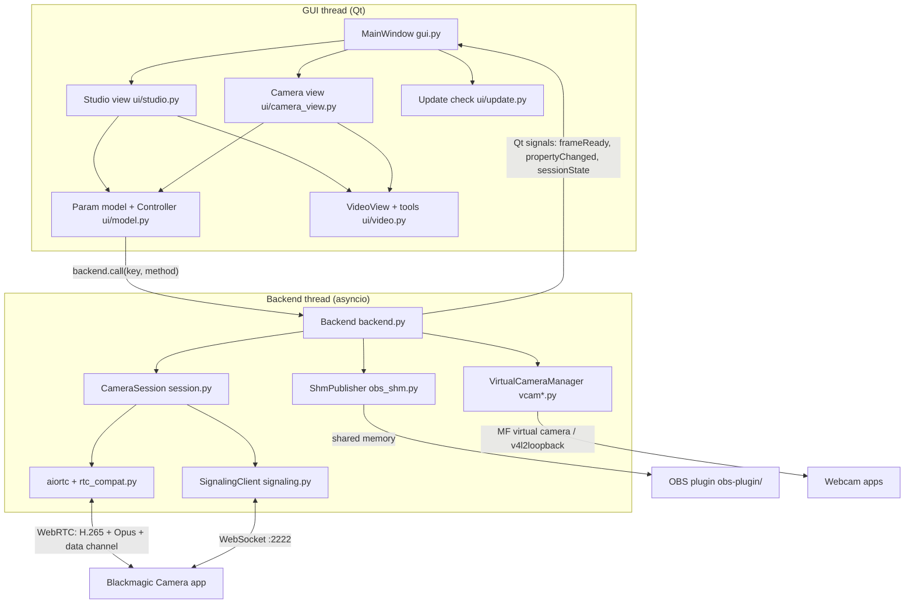

# CineRemote architecture

How CineRemote is put together, why it is built the way it is, and what each part depends on. Read this
before changing the protocol code, the outputs, packaging or the updater. For using the app see the
[README](../README.md); for working on the repo (commands, release steps) see [`CLAUDE.md`](../CLAUDE.md).

- [Big picture](#big-picture)
- [Threads](#threads)
- [The camera protocol](#the-camera-protocol)
- [Low-latency receive path](#low-latency-receive-path)
- [Backend and camera handles](#backend-and-camera-handles)
- [User interface](#user-interface)
- [Outputs: OBS plugin and virtual webcam](#outputs-obs-plugin-and-virtual-webcam)
- [Settings and secrets](#settings-and-secrets)
- [Demo mode](#demo-mode)
- [Updater](#updater)
- [Packaging and CI](#packaging-and-ci)
- [Testing](#testing)
- [Platform quirks we hit](#platform-quirks-we-hit)

## Big picture

| Layer | Files | Job |
|---|---|---|
| Protocol | `signaling.py`, `session.py`, `rtc_compat.py`, `proto_msgs.py`, `proto/` | Talk to one phone: sign in, WebRTC, protobuf control |
| Backend | `backend.py`, `diag.py`, `demo.py` | Every camera's connection on one asyncio loop; reconnects; audio gain/meters; feeds the outputs |
| Outputs | `obs_shm.py` + `obs-plugin/`, `vcam.py` + `vcam_win.py` / `vcam_v4l2.py` + `vcam/` | Clean frames to OBS and to a system webcam |
| UI | `gui.py`, `ui/*.py` | Two views over one parameter model; monitoring tools; update dialog |
| Distribution | `updater.py`, `packaging/`, `.github/workflows/build.yml` | Bundles, installers, releases, in-app updates |

## Threads

| Thread | Owner | Does |
|---|---|---|
| GUI (main) | Qt | Painting, input, the parameter model. Never blocks on the network. |
| `cineremote-asyncio` | `Backend` | One event loop for **all** cameras: WebSocket, ICE/DTLS/SRTP, RTP depacketizing, H.265 decode callbacks, protobuf, heartbeats, reconnect loops. |
| Default executor | `Backend` | Blocking virtual-webcam host I/O (`_attach_vcam_sync`). |
| Writer threads | `VcamWriter` / `V4l2Writer` | Scale + convert frames for the webcam off the loop. |
| Audio sink | `AudioMonitor` (`ui/audio.py`) | "Listen on PC" playback via `QAudioSink`. |
| `demo-<name>` | `DemoSession` | Demo frames/audio at 30 fps (`time.sleep` pacing, see quirks). |
| `update-check` / `update-download` | `ui/update.py` | GitHub requests, so the UI never waits. |

Cross-thread rules:

- Backend → GUI only through Qt signals (`frameReady`, `propertyChanged`, `sessionState`, `error`,
  `eventReceived`, `cameraListChanged`). They are queued to the GUI thread.
- GUI → backend only through `Backend.call(key, method, *args)` / `connect_camera` / `disconnect_camera`,
  which `run_coroutine_threadsafe` onto the loop.
- The latest decoded frame is shared through `CamHandle.latest` under `CamHandle.lock`. Every consumer
  (each view, OBS publisher, webcam writer) owns its **own** `VideoReformatter`: sharing one
  `frame.reformat()` context across threads deadlocked inside `sws_scale`.

## The camera protocol

The Blackmagic Camera app (iOS/Android, tested with 3.5, remote protocol 5.0) has a *Remote Camera* mode.
CineRemote plays the *controller* role. Everything below was verified against real phones (Pixel 10,
Galaxy S24 Ultra, iPhone 16, iPad Pro).

1. **Discovery** - mDNS service `_bmd-cam-control._tcp`, port 2222. TXT records carry `name`,
   `model_name`, `slate_name`. Android re-registers as `<uuid> (2)`, `(3)`... after an app restart before
   the old record expires; `backend._camera_key()` strips that so one phone stays one camera.
2. **Signaling** (`signaling.py`) - JSON over WebSocket:
   `hello_request {info, nonce}` → `hello_response {status ready|busy, nonce}` →
   `conn_request {password: hex(sha256(nonce64 ‖ sha256(pw ‖ SALT1) ‖ SALT2))}` → `conn_response authorized`.
   The password itself never crosses the network.
3. **WebRTC** - the **phone always sends the offer**; the controller only answers. Sending our own first
   offer breaks the session. The first offer can be empty (no m-lines): answer minimally and wait.
   The data channel is named `signaling-channel`.
4. **Control** - protobuf `ControllerMessages` / `SubordinateMessages` on the data channel
   (`proto/*.proto`, package `cineremote.camctl.v5`; package names never travel on the wire, only field
   numbers). `HelloRequest/Response`, then `ReadPropertyRequest` for every `PropertyId` and
   `PropertyChangedEvent`s after that. Properties land in `CamHandle.props[field]` as message objects.
   `AppInfo(name="Blackmagic Camera", version="3.5.0")` is protocol identity the phone expects, not branding.
5. **Preview** - `StartPreviewRequest` (**`frame_rate` is required** or nothing happens) makes the phone
   re-offer over the data channel (`webrtc_sdp_request`) with sendonly H.265 (or H.264) + Opus; we answer
   with `webrtc_sdp_response`.
6. **Writes** - `WritePropertyRequest`. Android answers with `current_value`; **iOS applies the write but
   sends neither `current_value` nor a `PropertyChangedEvent`** (e.g. frame rate), so `session.write()`
   re-reads the property when the response has no value. iOS also reports frame-rate ranges as min/max
   only, so `model.Fps` offers the standard rates inside the range.
7. **Timecode** - `RecordingStateProperty` never carries a running count. While recording,
   `system_timecode` = the wall-clock **start** of the take (Unix seconds + frame count; iOS also sends a
   Unix time when idle) and the controller counts from it - exactly what Blackmagic's own controller does
   (decompiled `appcam/d.java` `o()`/`p()`). Idle: `recorded_duration` = last clip length.
   `model.recording_elapsed()` falls back to `CamHandle.rec_started` (when we saw recording begin) if the
   start is missing or the clocks disagree; the GUI repaints the big timecode at 10 Hz while recording.
8. **Disconnect** - `DisconnectEvent` → close data channel → close peer connection. Skipping it (crash,
   `kill -9`) wedges the phone's listener: it authorizes the next controller, then says `bye
   app_suspended` after ~20 s until the app is restarted. Hence the SIGTERM/SIGINT handler in `gui.main`
   and `aboutToQuit → backend.shutdown`.
9. **One controller at a time.** A second controller makes the phone drop or wedge the first.

The `.proto` files are this project's own description of the protocol (field numbers match the app).
`tools/gen_proto.py` compiles them into `proto/schema.pb` (a `FileDescriptorSet`), which
`proto_msgs.py` loads at runtime - users never need `protoc`.

## Low-latency receive path

`rtc_compat.py` patches aiortc for the phone's GStreamer `webrtcbin`:

| Patch | Why |
|---|---|
| DTLS cipher list widened | webrtcbin presents an RSA certificate; aiortc only allowed ECDHE-ECDSA. |
| H.265 codec | Many phones only offer HEVC. RFC 7798 depayloader + PyAV `hevc` decoder. |
| Marker-bit jitter buffer | aiortc completes a frame only when the next frame starts (+33-42 ms); we complete on the RTP marker bit and release audio immediately. Bigger video buffer for 1080p keyframes. |
| Hole deadline | The phones offer no generic NACK, so lost packets are never resent: give up on a gap after 20 ms and ask for a keyframe (PLI) instead of waiting. |
| Decoder threading | FFmpeg frame threads hold back `threads-1` frames (625 ms on 16 threads). Use `low_delay` + slice threads. |

Measured: ~8 ms median from last RTP packet to a decoded frame in the app, ~200 ms glass-to-glass
(almost all phone encode + Wi-Fi). `--diag` logs fps, PC-side latency, gaps, damaged frames, loop lag and
CPU every 5 s (`diag.py`; timestamps ride on aiortc's `JitterFrame` into `frame.opaque`).

## Backend and camera handles

`Backend` (`backend.py`) owns a `CamHandle` per camera key (mDNS key, `manual-<host>:<port>` or `demo-<n>`):

- `want_connected` + exactly **one** connect loop per camera (`_connect_loop`), with backoff 2 → 15 s
  (reset when the last session lived > 30 s). No video after `StartPreview` twice ⇒ raise and reconnect
  rather than sit on a black monitor.
- Session factory: `CameraSession` normally, `DemoSession` when `h.demo` is set - so demo cameras go
  through the same connect/preview/OBS path.
- `_video()` stamps `perf_counter_ns` (the OBS clock on every OS), stores `latest`, emits `frameReady`,
  pushes to the OBS publisher and the webcam.
- `_audio()` resamples to s16 stereo 48 kHz, applies the **PC-side** gain/mute (the protocol has no mic
  gain), updates RMS/peak meters, feeds OBS and the listen tap.
- `armed` (record-arm) is per handle; `MainWindow.record_targets()` = armed live cameras, else all live.

## User interface

- **One model, two views.** `ui/model.py` has a `Param` per setting (lens, fps, shutter, ISO, WB, tint,
  EV, focus, zoom). Each turns `CamHandle.props` into a `State` (text, sub-line, auto, value, choices or
  range) and knows which session method sets it. Views only paint. `Controller.send_throttled` limits
  ruler drags to one command per method every 120 ms (newest wins).
- **Studio view** (`ui/studio.py`): `CameraCard`s (live thumbnail, tally, battery/media, record-arm ring,
  preview switch), monitor (`VideoView`), multiview grid, vertical audio meter, control deck
  (`ParamTile`s + `ScrubRuler` + record button).
- **Camera view** (`ui/camera_view.py`): the phone app's layout; overlay panels are `CachedPanel`s
  (re-rendered into a pixmap only when content changes, since they sit over 30 fps video).
- **VideoView** (`ui/video.py`): frames arrive via `frameReady` (no polling); `bgra` reformat at display
  size into `QImage.Format_RGB32` without a copy. Monitoring tools run on the display-size picture:
  histogram, zebras, focus peaking (Y plane), false color (Indexed8 LUT), guides, grid. They never touch
  the outputs - OBS and the webcam always get the clean picture.
- **Meters** (`ui/widgets.py`): linear dB scale −50…0; zones by dB: green, orange ≥ −12, red ≥ −6;
  unlit segments tinted so zones always show. `VMeter` (Studio), `HMeter` (Camera view), multiview minis.
- **Look** (`ui/theme.py`): Windows uses Segoe UI Variable / Bahnschrift / Segoe Fluent Icons; macOS and
  Linux use the bundled Inter / Barlow Semi Condensed / Fluent UI System Icons with mapped code points.
  Widgets are custom-painted; stylesheet rules use objectName selectors (a parent background otherwise
  cascades into QLabels).

## Outputs: OBS plugin and virtual webcam

**OBS** - `obs_shm.py` publishes each connected camera into a shared-memory slot (up to 8):

- Windows: named mapping `Local\CineRemote_v1_slot<N>` + auto-reset event (zero-latency wakeups).
- Linux/macOS: POSIX `shm_open("/cineremote_v1_s<N>")` (macOS caps names at 31 chars); the plugin polls
  the header every 2 ms; readers use a read fence on ARM.
- Layout is defined twice and must match: `obs_shm.py` docstring and `obs-plugin/src/cineremote-shm.h`
  (4 KiB header: magic `BMCR`, generation, heartbeat, name, camera id, 3 rotating I420 video buffers,
  an int16 audio ring with a monotonic write counter and pts).
- The plugin (`plugin-main.c`, source id `cineremote_camera`, settings `camera_id` / `audio` /
  `buffered`) is an **unbuffered async source** - OBS's buffered mode added ~1.2 s of drift.
- Builds: Windows links obs.dll through `obs-imports.def` (no OBS install needed - add a name there if the
  plugin starts calling a new libobs function); macOS `OBS_UNIVERSAL=1` builds arm64+x86_64 with
  `-undefined dynamic_lookup`; Linux links `-lobs` from the obsproject PPA headers.

**Webcam**

- Windows (`vcam_win.py`, `vcam/`): a Media Foundation virtual camera DLL loaded by the Camera Frame
  Server (registered once, admin) + `cineremote-vcam-host.exe` that creates **persistent** (System
  lifetime) cameras as the user. Identity = (friendly name, slot CLSID); `%LOCALAPPDATA%\CineRemote\
  vcam_slots.json` keeps a phone on the same webcam across runs. Frames go through `Global\` shared memory
  only while a reader is active. The DLL file name is versioned because Frame Server keeps the old one
  loaded. Uninstall runs `CineRemote --remove-webcams`.
- Linux (`vcam_v4l2.py`): v4l2loopback devices 40-43, `write()` of 1920×1080 YU12, letterboxed.
- macOS: none (needs an Apple-signed camera extension). Use OBS's Virtual Camera.

## Settings and secrets

`QSettings("CineRemote", "CineRemote")` keys: `view`, `manual_hosts`, `cards/<key>/live`,
`cards/<key>/armed`, `audio/<key>/gain_db`, `audio/<key>/mute`, `updates/auto`, `updates/last_check`.
Phone passwords live in the OS keychain via `keyring` (service `cineremote`, user = camera key).
Logs: `<temp>/cineremote.log`, `<temp>/cineremote-update.log`.

## Demo mode

`--demo` (`demo.py`) adds five `DemoSession` cameras (A-D connected, E offline; A and B recording and
armed). `DemoSession` mirrors `CameraSession`'s surface: properties start from a real phone's property
dump (`demo_props.json`) with per-camera overrides, setters update them, frames come from
`assets/demo/*.jpg` (CC0) drifting slowly on a 30 fps thread, audio is speech-like noise that reaches the
orange/red meter zones. The webcam is off for demo cameras; OBS output is on. README screenshots are
`--demo --screenshot <png> --view … --select N --tools …`.

## Updater

`updater.py` + `ui/update.py`:

1. On start (5 s later, at most every 12 h, if `updates/auto`) GET
   `api.github.com/repos/jimmyvegas29/cineremote/releases/latest`; tag vs `__version__`
   (`parse_version`, pre-releases sort first). A newer release shows **Update available** in the top bar.
2. The dialog renders the release body (= the CHANGELOG section) as Markdown.
3. **Download** the asset for this install kind and verify it against `SHA256SUMS.txt` from the same
   release. Requests use a **certifi** CA bundle: the python.org-based macOS app has no root certificates
   and fresh Windows machines may not have GitHub's root cached.
4. **Apply** by install kind (`install_kind()`):

| Kind | Asset (name contract with CI) | Apply |
|---|---|---|
| `windows` | `CineRemote-<v>-windows-x64-setup.exe` | Hidden PowerShell `Wait-Process` on the app's PID, then the Inno installer `/SILENT /SP- /NOCANCEL /CLOSEAPPLICATIONS /relaunch=1` (starting setup while the app was still closing made it roll back) |
| `macos` | `CineRemote-<v>-macos-<arm64\|x86_64>.zip` | `ditto -x -k`, then a shell script swaps the `.app` after the app exits, clears quarantine, `open`s it |
| `appimage` | `CineRemote-<v>-linux-x86_64.AppImage` | Replace `$APPIMAGE` in place (`os.replace`), re-exec after exit |
| `source` | - | Tell the user to `git pull` |

`CineRemote --update-now` runs the same steps headless without relaunching (scripted installs, tests).

## Packaging and CI

- `packaging/cineremote.spec` (PyInstaller, onedir): bundles `schema.pb`, fonts, icon, `demo_props.json`,
  demo photos and (Windows) the webcam DLL/host + install scripts. Strips Qt pieces the app never uses
  (software OpenGL, QML/Quick, PDF, translations, virtual keyboard). macOS `Info.plist` has
  `NSLocalNetworkUsageDescription` and `NSBonjourServices = [_bmd-cam-control._tcp]` - without them macOS
  won't let the app see phones.
- Windows installer `packaging/windows/cineremote.iss` (Inno Setup 6): app in `Program Files\CineRemote`,
  OBS plugin in `ProgramData\obs-studio\plugins`, versioned webcam DLL registered with `regserver`,
  `ProgramData\CineRemote` ACL via icacls (LocalService modify), `[Code] Relaunch` for `/relaunch=1`.
- Linux `packaging/linux/build_appimage.sh` (appimagetool, extract-and-run so no FUSE needed in CI);
  macOS `packaging/macos/build_app.sh` (ad-hoc codesign, `ditto` zip for the updater) then
  `packaging/macos/build_dmg.sh` (drag-to-Applications disk image: Applications symlink, HiDPI background
  from `tools/make_dmg_background.py`, volume icon, Finder layout via AppleScript - skipped with a default
  layout where Finder can't be scripted, e.g. over SSH).
- `.github/workflows/build.yml`: Windows (2022), Ubuntu 22.04 (oldest glibc for the AppImage),
  macOS 15 (arm64) and macOS 15 Intel. Each job smoke-tests from source **and** the bundle
  (`--demo --quit-after N`, `QT_QPA_PLATFORM=offscreen`). A `v*` tag must equal `__version__`; the release
  job publishes every artifact + `SHA256SUMS.txt` with the CHANGELOG section as notes.
- Python **3.12** everywhere (see quirks). Intel Macs pin `cryptography<49` (no x86_64 wheel after 48).

## Testing

| Check | How |
|---|---|
| App starts and renders | `QT_QPA_PLATFORM=offscreen python cineremote.py --demo --quit-after 6` (exit 0) |
| Screenshots | `python cineremote.py --demo --view studio --select 0 --screenshot out.png --screenshot-after 7 --quit-after 9` |
| OBS end to end | `python tools/obs_record_test.py --demo` (records through the plugin, decodes frames) |
| Against a phone | `tools/session_test.py --host IP --password PW`, `tools/headless_publish.py`, `tools/latency_probe.py IP PW`, `--diag` |
| Updater | `CineRemote --update-now` on an installed older version; GUI path via **Update available** |

## Platform quirks we hit

- **PySide6 6.12 Linux wheels + Python 3.11:** `QPainter.setPen` drops a reference to `None` on every call;
  Python 3.11 aborts (`none_dealloc`) within seconds. 3.12+ makes `None` immortal. Hence 3.12 minimum on
  Linux (`cineremote.py` refuses older).
- **asyncio timers on Windows tick at ~15 ms** - paced loops come out at 24-25 fps. Use a thread with
  `time.sleep` for anything frame-paced (demo).
- **numpy views of a `QImage`** must be copied before the `QImage` is freed (demo crash).
- **QtSvg ignores `clipPath`** (SVG Tiny) - draw shapes exactly (`tools/make_icons.py`).
- **macOS Local Network privacy:** a Python started by `launchctl asuser` is silently denied; from
  source run via Terminal (`run_mac.command`), the bundle declares its Bonjour service.
- **macOS OBS first launch** shows a Permissions dialog; `tools/obs_record_test.py` sets
  `MacOSPermissionsDialogLastShown`.
- **Linux Qt** needs `libxcb-cursor0`. Ubuntu's DKMS v4l2loopback can lag new kernels.
- **Inno Setup** has no LocalService SID name for `[Dirs] Permissions` - use icacls in `[Run]`.
- **OBS** stores the webcam device path; after a webcam identity change re-pick the device once.
